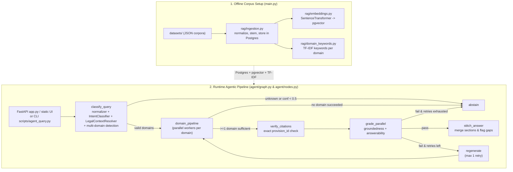

# Legal Workflow Generator — Codebase Guide & Dead-Code Audit

This document provides a complete map of the **Legal Workflow Generator** codebase: every major folder and subfolder, what each module does, how data and control flow through the system, and an audit of possible dead code and cleanup candidates.

---

## 1. High-Level Architecture & Code Flow

The system is an **Agentic RAG (Retrieval-Augmented Generation)** application built on **LangGraph**, **LangChain**, **PostgreSQL + `pgvector`**, **BM25**, and **FastAPI**. It takes a user's legal/compliance question (covering Indian statutory law across 5 domains: `data_protection`, `corporate_governance`, `ip_licensing`, `taxation`, `employment`), retrieves relevant statutory provisions, generates a cited compliance workflow, verifies citations and claim entailment, and grades groundedness and answerability before returning a final stitched answer (or abstaining).

### End-to-End Flow

### Inside `domain_pipeline` (Per-Domain Parallel Worker)
For each detected domain, a worker runs concurrently (with `contextvars` propagated from `agent/settings.py`):
1. **Retrieve**: Hybrid BM25 + `pgvector` semantic search (`rag/hybrid_search.py`, supporting `linear`, `minmax`, or `rrf` fusion), filtered to the domain (with optional statute-scoped search, planner-suggested provisions, anchor provisions, and temporal `as_of` filtering).
2. **Grade Context (and optional Context Selection)**: LLM (`RelevanceGrade`) checks if retrieved provisions are sufficient. When `select_context=True` (v4), `_grade_select` evaluates a wider candidate pool (`select_pool`, default 20) and selects the most relevant provisions (up to `select_max`, default 10) for generation.
3. **Rewrite & Retry**: On insufficiency, rewrites the search query (`SearchQuery`) and retries retrieval (up to `max_domain_retries`, default 1).
4. **Generate**: Produces a structured `DomainWorkflow` (`summary`, `steps[]` with `provision_id` constrained to a dynamic `Literal` enum of retrieved IDs, and `not_covered`).
5. **Claim Verification** (optional, default on): Checks each generated step against the text of its cited provision (entailment check), dropping unsupported steps.

---

## 2. Top-Level Directory Structure

| Path | Role |
|---|---|
| [app.py](file:///Users/yathartha/Desktop/Legal-Workflow-Generator/app.py) | FastAPI web server with startup pre-warming (`lifespan`), serving the chat/inspector UI (`/`) and API endpoints (`/api/chat`, `/api/chat/stream` SSE, `/api/test/query`, `/api/test/rag`). |
| [main.py](file:///Users/yathartha/Desktop/Legal-Workflow-Generator/main.py) | CLI entrypoint for database lifecycle: `setup`, `ingest [condensed\|complete]`, `embed [all]`, `extract-keywords`. |
| [docker-compose.yml](file:///Users/yathartha/Desktop/Legal-Workflow-Generator/docker-compose.yml) | Spins up `pgvector/pgvector:pg17` Postgres container on port `5432`. |
| [pyproject.toml](file:///Users/yathartha/Desktop/Legal-Workflow-Generator/pyproject.toml) | Project dependencies (`uv`), `pytest` configuration (deselects `integration` by default), and `coverage` settings. |
| [run_evals_core.py](file:///Users/yathartha/Desktop/Legal-Workflow-Generator/run_evals_core.py) | Paper evaluation runner (steps 1–4: retrieval baselines, hybrid RAG, full pipeline base & suggest). |
| [run_evals_extra.py](file:///Users/yathartha/Desktop/Legal-Workflow-Generator/run_evals_extra.py) | Follow-up evaluation runner (steps 5–6: stability repeat & independent-judge step entailment). |
| `legal_workflow_generator/` | Core Python library package (detailed below). |
| `datasets/` | Source legal JSON corpora (`condensed/` and `complete/`) and dataset-building scripts. |
| `scripts/` | Standalone CLI utilities for querying the agent, running batches, checking DB, and validating search. |
| `evals/` | Evaluation harnesses, expert-review tooling, report generators, and saved run artifacts (`evals/results/`). |
| `tests/` | `pytest` unit, pipeline, integration, and browser tests. |
| `docs/` | Architecture diagrams, evaluation write-ups, and working notes. |

---

## 3. Core Package: `legal_workflow_generator/`

### `legal_workflow_generator/agent/` — LangGraph Agentic Pipeline
The heart of Phase 3 (self-corrective, multi-domain agentic RAG).
- [graph.py](file:///Users/yathartha/Desktop/Legal-Workflow-Generator/legal_workflow_generator/agent/graph.py): Defines the `StateGraph`, conditional routing (`route_after_classify`, `route_after_domain_pipeline`, `route_after_grades`), compiles the singleton `graph`, and exposes `run_workflow(query, ...)`.
- [state.py](file:///Users/yathartha/Desktop/Legal-Workflow-Generator/legal_workflow_generator/agent/state.py): Defines `AgentState(TypedDict)` carrying query metadata, retrieved docs, per-domain results, grades, retry counters, and execution trace.
- [models.py](file:///Users/yathartha/Desktop/Legal-Workflow-Generator/legal_workflow_generator/agent/models.py): Typed dataclasses (`Provision`, `Step`, `DomainResult`), `LLMUnavailable`, and domain constants (`VALID_DOMAINS`, `_DOMAIN_ORDER`, `_DOMAIN_LABELS`, `APPLIES_TO`).
- [prompts.py](file:///Users/yathartha/Desktop/Legal-Workflow-Generator/legal_workflow_generator/agent/prompts.py): Prompt builders (`grade_domain_prompt`, `generate_domain_prompt`) for per-domain grading and workflow generation.
- [nodes.py](file:///Users/yathartha/Desktop/Legal-Workflow-Generator/legal_workflow_generator/agent/nodes.py): Implements all graph nodes (`classify_query`, `domain_pipeline`, `verify_citations`, `grade_parallel`, `stitch_answer`, `abstain`), corpus/anchor lookups, v4 context selection (`_grade_select`, `_keep_selected`), temporal filtering, and the unified `_llm()` retry/rate-limit boundary.
- [settings.py](file:///Users/yathartha/Desktop/Legal-Workflow-Generator/legal_workflow_generator/agent/settings.py): Immutable `RunSettings` dataclass + `contextvars` helpers (`use_settings`, `current_settings`, `build_config`) so per-request options (`provider`, `top_k`, `as_of`, `verify_claims`, `select_context`, `select_pool`, `select_max`, `fusion`, etc.) flow through LangGraph `config` into parallel worker threads.
- [llm_limits.py](file:///Users/yathartha/Desktop/Legal-Workflow-Generator/legal_workflow_generator/agent/llm_limits.py): Process-wide sliding-window RPM + in-flight concurrency `RateLimiter` (`LIMITERS["gemini"]`, `LIMITERS["groq"]`).
- [gemini_client.py](file:///Users/yathartha/Desktop/Legal-Workflow-Generator/legal_workflow_generator/agent/gemini_client.py): `RotatingGeminiClient` and `KeyPool` supporting comma-separated `GEMINI_API_KEY` rotation with per-key cooldowns and token usage tracking (`USAGE`).
- [groq_client.py](file:///Users/yathartha/Desktop/Legal-Workflow-Generator/legal_workflow_generator/agent/groq_client.py): Token-per-minute (TPM) paced Groq completion client with usage tracking and daily-limit detection (`GroqDailyLimit`).

### `legal_workflow_generator/llm/` — Shared LangChain & Structured Output Layer
- [__init__.py](file:///Users/yathartha/Desktop/Legal-Workflow-Generator/legal_workflow_generator/llm/__init__.py): Cached `chat_model()` (Gemini) and `groq_chat_model()` (Groq), plus `structured_llm()` and `invoke_structured()` which enforce Pydantic validation and raise `StructuredOutputError` on schema mismatches.
- [schemas.py](file:///Users/yathartha/Desktop/Legal-Workflow-Generator/legal_workflow_generator/llm/schemas.py): Pydantic schemas for all structured LLM calls (`IntentClassification`, `DomainClassification`, `DomainList`, `SearchQuery`, `RelevanceGrade`, `GroundednessGrade`, `AnswerabilityGrade`, and dynamic `domain_workflow_model(allowed_ids)`).

### `legal_workflow_generator/query/` — Query Processing Unit (Phase 2 & 3)
Transforms raw text (or PDF) into a structured `LegalContext`.
- [__init__.py](file:///Users/yathartha/Desktop/Legal-Workflow-Generator/legal_workflow_generator/query/__init__.py): `process_query(text, pdf_path)` single-entry pipeline.
- [normalizer.py](file:///Users/yathartha/Desktop/Legal-Workflow-Generator/legal_workflow_generator/query/normalizer.py): `QueryNormalizer` — cleans text, expands legal abbreviations, validates input, and extracts text from PDFs (`pdfplumber`).
- [intent_classifier.py](file:///Users/yathartha/Desktop/Legal-Workflow-Generator/legal_workflow_generator/query/intent_classifier.py): `IntentClassifier` — classifies intent (`qa`, `workflow`, `compliance_check`, `unknown`) with confidence via structured LLM output.
- [keyword_domain_classifier.py](file:///Users/yathartha/Desktop/Legal-Workflow-Generator/legal_workflow_generator/query/keyword_domain_classifier.py): `KeywordDomainClassifier` — fast, deterministic domain scorer using TF-IDF keywords extracted from the corpus.
- [context_resolver.py](file:///Users/yathartha/Desktop/Legal-Workflow-Generator/legal_workflow_generator/query/context_resolver.py): `LegalContextResolver` — combines `KeywordDomainClassifier` and LLM classification (`llm_fallback` or `combine` strategy, plus optional self-consistency majority voting) to produce `LegalContext`.

### `legal_workflow_generator/rag/` — Storage, Indexing, Hybrid Retrieval & Phase 2 Generation
- [setup.py](file:///Users/yathartha/Desktop/Legal-Workflow-Generator/legal_workflow_generator/rag/setup.py): Creates Postgres `pgvector` extension, `laws` table, indexes, and schema.
- [ingestion.py](file:///Users/yathartha/Desktop/Legal-Workflow-Generator/legal_workflow_generator/rag/ingestion.py): Normalizes/stems statutory text, resolves domains, and upserts JSON datasets into Postgres.
- [embeddings.py](file:///Users/yathartha/Desktop/Legal-Workflow-Generator/legal_workflow_generator/rag/embeddings.py): Encodes provisions with `sentence-transformers` and stores vectors in `pgvector`.
- [domain_keywords.py](file:///Users/yathartha/Desktop/Legal-Workflow-Generator/legal_workflow_generator/rag/domain_keywords.py): Computes distinctive TF-IDF terms per domain from the ingested corpus for `KeywordDomainClassifier`.
- [bm25_retriever.py](file:///Users/yathartha/Desktop/Legal-Workflow-Generator/legal_workflow_generator/rag/bm25_retriever.py): `BM25Retriever` — in-memory BM25 index over corpus provisions.
- [hybrid_search.py](file:///Users/yathartha/Desktop/Legal-Workflow-Generator/legal_workflow_generator/rag/hybrid_search.py): `HybridSearcher` — fuses BM25 lexical scores and `pgvector` cosine similarity.
- [generator.py](file:///Users/yathartha/Desktop/Legal-Workflow-Generator/legal_workflow_generator/rag/generator.py): Phase 2 free-form markdown answer generators (`GeminiAnswerGenerator`, `GroqAnswerGenerator`).
- [pipeline.py](file:///Users/yathartha/Desktop/Legal-Workflow-Generator/legal_workflow_generator/rag/pipeline.py): `RagPipeline` — wraps `HybridSearcher` + `AnswerGenerator` (used by `/api/test/rag`, `demo_query_rag.py`, and as the search backend inside `agent/nodes.py`).

### `legal_workflow_generator/config/`, `typings/`, `presentation/`
- [config/values.py](file:///Users/yathartha/Desktop/Legal-Workflow-Generator/legal_workflow_generator/config/values.py): Loads `.env` from repo root; validates required env vars (`PGPASSWORD`, `GEMINI_API_KEY`) and exposes DB, Gemini, Groq, and context-resolver settings.
- [typings/types.py](file:///Users/yathartha/Desktop/Legal-Workflow-Generator/legal_workflow_generator/typings/types.py): Shared `TypedDict`s (`LawSchema`, `NormalizedQuery`, `LegalContext`) and `QueryIntent` enum.
- `presentation/static/` ([index.html](file:///Users/yathartha/Desktop/Legal-Workflow-Generator/legal_workflow_generator/presentation/static/index.html), [app.js](file:///Users/yathartha/Desktop/Legal-Workflow-Generator/legal_workflow_generator/presentation/static/app.js), [style.css](file:///Users/yathartha/Desktop/Legal-Workflow-Generator/legal_workflow_generator/presentation/static/style.css)): Single-page chat and real-time streaming pipeline-inspector frontend served by `app.py`.

---

## 4. Supporting Folders

### `datasets/`
- `condensed/` & `complete/`: Per-domain JSON files (`corporategovernance`, `dpdp`, `employee_laws`, `softwarelicensing`, `tax`) and their merged `combined_*_dataset.json` files.
- [build_dpdp.py](file:///Users/yathartha/Desktop/Legal-Workflow-Generator/datasets/build_dpdp.py) & [combine_complete.py](file:///Users/yathartha/Desktop/Legal-Workflow-Generator/datasets/combine_complete.py): Build and merge complete JSON corpora.
- [counter.py](file:///Users/yathartha/Desktop/Legal-Workflow-Generator/datasets/counter.py): Prints provision counts/statistics.
- [extract_pdf_text.py](file:///Users/yathartha/Desktop/Legal-Workflow-Generator/datasets/extract_pdf_text.py) & [temp.py](file:///Users/yathartha/Desktop/Legal-Workflow-Generator/datasets/temp.py): One-off / temporary data prep utilities.

### `scripts/`
- [agent_query.py](file:///Users/yathartha/Desktop/Legal-Workflow-Generator/scripts/agent_query.py): Run a single query through the Phase 3 agent from the CLI.
- [run_batch.py](file:///Users/yathartha/Desktop/Legal-Workflow-Generator/scripts/run_batch.py): Run queries from [queries.txt](file:///Users/yathartha/Desktop/Legal-Workflow-Generator/scripts/queries.txt) in batch.
- [demo_query_rag.py](file:///Users/yathartha/Desktop/Legal-Workflow-Generator/scripts/demo_query_rag.py): Demo script for Phase 2 Query + RAG pipeline.
- [run_units.sh](file:///Users/yathartha/Desktop/Legal-Workflow-Generator/scripts/run_units.sh): Shell wrapper for running query/rag/demo units.
- [check_db.py](file:///Users/yathartha/Desktop/Legal-Workflow-Generator/scripts/check_db.py) & [validate_search.py](file:///Users/yathartha/Desktop/Legal-Workflow-Generator/scripts/validate_search.py): DB inspection and search validation utilities.

### `evals/`
- **Orchestration**: [runner.py](file:///Users/yathartha/Desktop/Legal-Workflow-Generator/evals/runner.py), [run_status.py](file:///Users/yathartha/Desktop/Legal-Workflow-Generator/evals/run_status.py), [make_report.py](file:///Users/yathartha/Desktop/Legal-Workflow-Generator/evals/make_report.py).
- **Current Paper Harnesses**: [eval_complete_multidomain.py](file:///Users/yathartha/Desktop/Legal-Workflow-Generator/evals/eval_complete_multidomain.py), [eval_baselines.py](file:///Users/yathartha/Desktop/Legal-Workflow-Generator/evals/eval_baselines.py), [eval_llm_pure.py](file:///Users/yathartha/Desktop/Legal-Workflow-Generator/evals/eval_llm_pure.py), [eval_worker_retrieval.py](file:///Users/yathartha/Desktop/Legal-Workflow-Generator/evals/eval_worker_retrieval.py), [eval_entailment.py](file:///Users/yathartha/Desktop/Legal-Workflow-Generator/evals/eval_entailment.py), [replay_generation.py](file:///Users/yathartha/Desktop/Legal-Workflow-Generator/evals/replay_generation.py).
- **Component / Earlier Harnesses**: [eval_domain_classification.py](file:///Users/yathartha/Desktop/Legal-Workflow-Generator/evals/eval_domain_classification.py), [eval_agent.py](file:///Users/yathartha/Desktop/Legal-Workflow-Generator/evals/eval_agent.py), [eval_phase2.py](file:///Users/yathartha/Desktop/Legal-Workflow-Generator/evals/eval_phase2.py), [eval_pipeline.py](file:///Users/yathartha/Desktop/Legal-Workflow-Generator/evals/eval_pipeline.py), [eval_pipeline_10query.py](file:///Users/yathartha/Desktop/Legal-Workflow-Generator/evals/eval_pipeline_10query.py).
- `expert_review/`: [RUBRIC.md](file:///Users/yathartha/Desktop/Legal-Workflow-Generator/evals/expert_review/RUBRIC.md), [build_review_sheet.py](file:///Users/yathartha/Desktop/Legal-Workflow-Generator/evals/expert_review/build_review_sheet.py), [score_reviews.py](file:///Users/yathartha/Desktop/Legal-Workflow-Generator/evals/expert_review/score_reviews.py) for blinded human legal evaluation.
- `results/`: Saved JSONL/CSV/Markdown outputs indexed by [RUNS.md](file:///Users/yathartha/Desktop/Legal-Workflow-Generator/evals/results/RUNS.md) (`gemini_v4/`, `gemini_v2/`, `dev/`, `devjudge_dev_base/`, `devjudge_dev_select2/`, `archive/`, `cache/`).

### `tests/`
- Fast offline unit tests (`conftest.py` injects dummy env vars) covering `query/`, `llm/`, `rag/generator.py`, `rag/ingestion.py`, `agent/` helpers, `app.py` routes, `evals/` runners, and `expert_review/`.
- `@pytest.mark.integration` tests ([test_conn.py](file:///Users/yathartha/Desktop/Legal-Workflow-Generator/tests/test_conn.py), [test_rag_pipeline.py](file:///Users/yathartha/Desktop/Legal-Workflow-Generator/tests/test_rag_pipeline.py), [test_agent.py](file:///Users/yathartha/Desktop/Legal-Workflow-Generator/tests/test_agent.py)) requiring live Postgres + Gemini.
- `tests/browser/` ([test_workflow_inspector.py](file:///Users/yathartha/Desktop/Legal-Workflow-Generator/tests/browser/test_workflow_inspector.py)): Browser UI test for the workflow inspector.

### `docs/`
- [CODEBASE_GUIDE.md](file:///Users/yathartha/Desktop/Legal-Workflow-Generator/docs/CODEBASE_GUIDE.md), [TESTS_AND_EVALS_GUIDE.md](file:///Users/yathartha/Desktop/Legal-Workflow-Generator/docs/TESTS_AND_EVALS_GUIDE.md), [CODE_ISSUES_AND_GAPS.md](file:///Users/yathartha/Desktop/Legal-Workflow-Generator/docs/CODE_ISSUES_AND_GAPS.md), [PHASE3_EVAL_RESULTS.md](file:///Users/yathartha/Desktop/Legal-Workflow-Generator/docs/PHASE3_EVAL_RESULTS.md), [DOMAIN_CLASSIFICATION_RELIABILITY.md](file:///Users/yathartha/Desktop/Legal-Workflow-Generator/docs/DOMAIN_CLASSIFICATION_RELIABILITY.md), [EVAL_STATUS.md](file:///Users/yathartha/Desktop/Legal-Workflow-Generator/docs/EVAL_STATUS.md), [architecture.png](file:///Users/yathartha/Desktop/Legal-Workflow-Generator/docs/architecture.png), and [workflow_pseudocode.py](file:///Users/yathartha/Desktop/Legal-Workflow-Generator/docs/workflow_pseudocode.py).

---

## 5. Remaining Optional Cleanup Candidates

*(Empty stubs, unused functions/constants/imports, duplicate `AgentState` fields, stale `/api/test/classify` reference, and `temp.*` files have already been cleaned up.)*

| File / Folder | Details |
|---|---|
| [datasets/extract_pdf_text.py](file:///Users/yathartha/Desktop/Legal-Workflow-Generator/datasets/extract_pdf_text.py) | Marked `"Temporary utility"` in its docstring for one-time PDF text dumping. |
| [docs/workflow_pseudocode.py](file:///Users/yathartha/Desktop/Legal-Workflow-Generator/docs/workflow_pseudocode.py) | Non-runnable pseudocode sketch; superseded by `agent/graph.py` and `agent/nodes.py`. |
| [evals/eval_pipeline_10query.py](file:///Users/yathartha/Desktop/Legal-Workflow-Generator/evals/eval_pipeline_10query.py) | Small ad-hoc 10-query smoke eval script; superseded by `eval_complete_multidomain.py` / `eval_pipeline.py`. |
| `evals/results/gemini_v2/v3_default_temp/` & `evals/results/gemini_v4/v4_default_temp/` | Partial default-temperature judge runs explicitly marked as superseded in [evals/results/RUNS.md](file:///Users/yathartha/Desktop/Legal-Workflow-Generator/evals/results/RUNS.md). |
